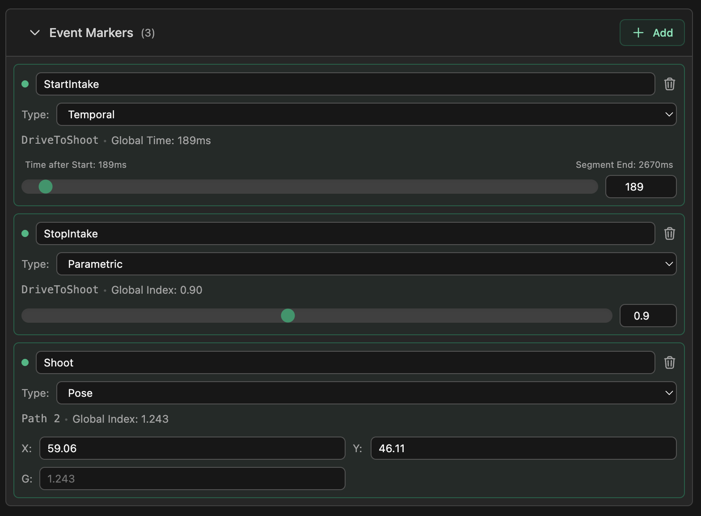

# Event Markers

Event markers allow you to trigger robot actions at precise moments during your autonomous routine. Whether you need to deploy an intake while driving, fire a mechanism while waiting, or spin up a flywheel while rotating, markers provide the synchronization you need.

## **Where Markers Go**

A marker belongs to one step of your sequence, and where it sits decides how it looks on the field:

- **Path Markers:** Triggered at a specific percentage along a driving path.
  - **Visual:** Purple dots ● on the path line.
- **Wait Markers:** Triggered at a specific percentage of a wait command's duration.
  - **Visual:** Purple circles with a **flag icon** ⚑ at the wait location.
- **Rotation Markers:** Triggered at a specific percentage of a rotation's completion.
  - **Visual:** Cyan circles with a **curved arrow icon** ↻ at the rotation location.

## **Managing Markers**

All markers are managed in the **Event Markers** panel, in the **Field** tab of the control panel.

1.  **Add a Marker:** Click the green **+ Add** button in the panel header. This adds a new marker to the end of your sequence.
2.  **Name It:** Type a name, or pick one you have already used from the dropdown (e.g., `"IntakeDeploy"`, `"Shoot"`). This name is used in your exported code to identify the event.
3.  **Choose a Type:** Use the **Type** dropdown to decide what makes the marker fire (see below). New markers are **Parametric**.
4.  **Position It:** The controls under the type depend on which one you picked.

## **Trigger Types**

- **Parametric** (default): Fires at a point along its step. Use the slider or number input to place it. The panel shows the position as a **Global Index**.
- **Temporal**: Fires at a set time. The slider and number input are in milliseconds, and the panel shows the **Time after Start** and the **Segment End** time of the step the marker is on.
- **Pose**: Fires when the robot gets close to a spot on the field. Enter the spot's **X** and **Y** in inches. The **G** field is optional: it says how far along the path the spot is, and when it is empty it is worked out from X and Y. In generated code the robot has to be within 2 inches of the spot.

## **Understanding Global Index**

The "Global Index" value represents exactly where a parametric marker falls in your entire sequence. A pose marker shows a Global Index too, counted in paths: in the screenshot above, `1.243` is 24% of the way along the second path.

- **The Whole Number (e.g., 1.xx):** Represents the **Step Index**.
  - `0.xx` is the **1st step**.
  - `1.xx` is the **2nd step**.
  - `2.xx` is the **3rd step**.
- **The Decimal (e.g., x.50):** Represents the **% Completion** of that step.
  - `.00` is the start (0%).
  - `.50` is the middle (50%).
  - `.99` is the end (99%).

> **Tip:** You can drag the slider to seamlessly move a marker from one step to another (e.g., sliding it from a Path directly into the following Wait).

## **In Your Code**

When you export your autonomous routine, event markers are generated as [TurtleTracerLib](/turtle-tracer-lib/named-commands/) events and command triggers based on the **Name** you assigned. Parametric markers become `onParametric` triggers, temporal markers become `onTemporal`, and pose markers become `onSpatial`. Register a command with the same name in `NamedCommands` (or bind one with `onEvent`) so your robot code performs the action. [Named Commands & Events](/turtle-tracer-lib/named-commands/) shows how, for OpMode exports (with the Command Registrar), a `RobotContainer`, and Sequential Command exports. In routines with several paths, each path registers only its own markers, so a marker triggers on the path you placed it on.
