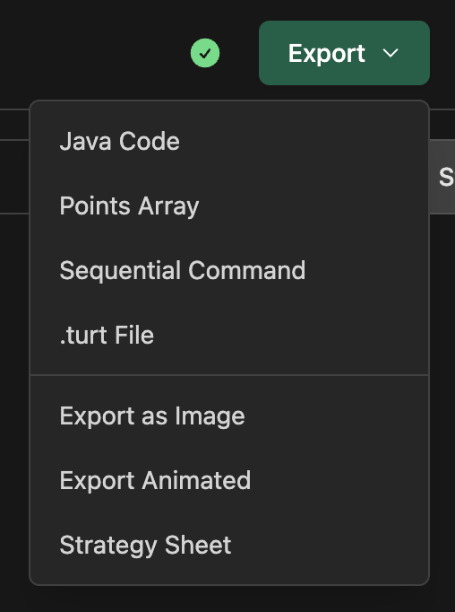
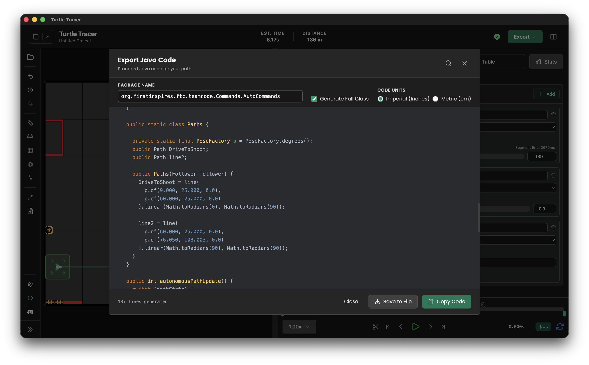
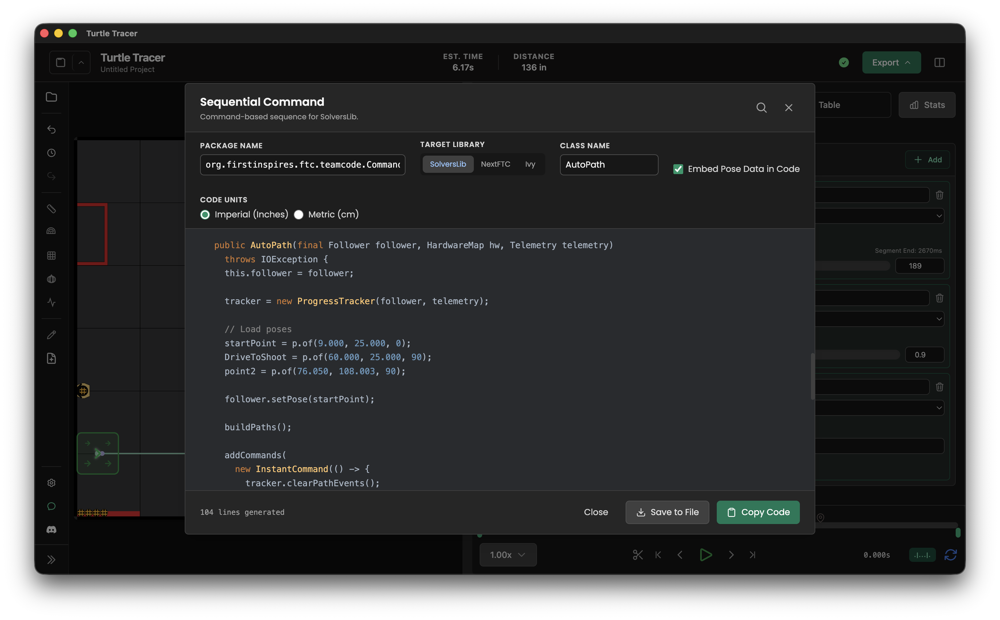

import { Tabs, TabItem } from "@astrojs/starlight/components";
import GeneratedCode from "../../../components/GeneratedCode.astro";

# Exporting Code

Turn your visualized paths into runnable robot code or shareable animations.

## How to Export

Every export starts from the **Export** menu in the top-right corner of the navigation bar.



1.  **Open the Export menu**: Click **Export**, then choose a format: **Java Code**, **Kotlin Code**, **Points Array**, **Sequential Command**, **.turt File**, **Export as Image**, **Export Animated**, or **Strategy Sheet**. You can also use a shortcut, such as <kbd>Ctrl</kbd> + <kbd>Shift</kbd> + <kbd>J</kbd> (or <kbd>Cmd</kbd> + <kbd>Shift</kbd> + <kbd>J</kbd> on macOS) for Java code. See [Controls & Shortcuts](/turtle-tracer/controls/#exporting) for the rest.
2.  **Adjust Options**: Each format opens a dialog with its own options. The ones you change often, such as **Language**, **Target Library**, and **Class Name**, stay in view. The dialog also shows whether the project mirrors for the alliance, which you set in the Field tab. Click **Options** to reach the set-once ones: **Package Name**, **Command Registrar** (OpMode exports), **Code Units** (imperial or metric), and **Generate Full Class** or **Embed Pose Data in Code**. The code preview updates as you change them.
3.  **Copy or Save**:
    - Click **Copy Code** to paste the generated code into Android Studio.
    - Click **Save to File** to download it as a `.java` file (`.kt` if you export Kotlin), or a `.txt` file for a points array. The **.turt File** dialog has a **Download as .turt** button instead.

## OpMode (Standard)

Generates a complete, standalone OpMode for your autonomous routine, in Java or [Kotlin](#kotlin). This does not support all the functionality of the program due to current limitations.



- **Full Class**: Creates a ready-to-run file including the `OpMode` structure, state machine, and path definitions.
- **Snippets**: Uncheck "Generate Full Class" to get just the path construction code for copy-pasting into your own classes.
- **Hardcoded Paths**: The geometry is baked into the generated file. You do **not** need to put the `.turt` file on the robot.
- **Event Markers**: Each marker becomes a `ProgressTracker` registration that runs the command you registered with `NamedCommands` under the marker's name.
- **Command Registrar** (optional): Name a method of yours, such as `org.firstinspires.ftc.teamcode.RobotCommands.register`, and the generated `init()` calls it with `hardwareMap` so your named commands exist before the first path starts. It's written only when the path has event markers. You set it under **Options**.

### Example Output

This is the OpMode generated for a three-path routine with a wait, a `SpinUp` event marker on the first path, and an `Intake` marker on the last. The paths are built in a `Paths` class, and a state machine follows them in order:

<GeneratedCode example="routine-opmode" />

Register the `SpinUp` and `Intake` commands before the routine runs. Without a Command Registrar, that means editing the generated `init()`, which the next export overwrites. With one, the export writes the call for you:

```java
follower = Constants.create(hardwareMap);
follower.setPose(p.of(9.000, 25.000, 0.000));

org.firstinspires.ftc.teamcode.RobotCommands.register(hardwareMap); // Team's named commands

pathTimer = new ElapsedTime();
paths = new Paths(follower); // Build paths
```

See [Named Commands & Events](/turtle-tracer-lib/named-commands/opmode-exports/) for the registration class and a step-by-step setup.

## Command-Based (Recommended, Advanced)

Generates a command group for use with command-based frameworks.



- **Supported Libraries**: Pick one with the library tabs in the export dialog, or with **Target Library** in [Settings](/turtle-tracer/settings/#code-export).
  - **SolversLib**: Standard integration.
  - **NextFTC**: Experimental support.
  - **Ivy**: Experimental support for Pedro Pathing's [Ivy](https://github.com/Pedro-Pathing/Ivy). Ivy builds commands with static factories, so the generated class hands back a `Command` from `command()` instead of extending one. Call `Scheduler.reset()` in `init()`, start the routine with `new AutoPath(follower, hardwareMap).command().schedule()`, and call `follower.update()` and `Scheduler.execute()` every loop.
- **Pose data**: **Embed Pose Data in Code** is on by default, so the poses are written into the class and you don't need the `.turt` file on the robot. Turn it off and the class uses `TurtleTracerReader` to load path data from the `.turt` file at runtime. **You must put your `.turt` file on the robot** for that to work. See [TurtleTracerReader](/turtle-tracer-lib/turtle-tracer-reader/).
- **Features**: Automatically handles `FollowPath`, `Wait`, `Turn`, and event triggers. Event markers use TurtleTracerLib events, and each path registers only its own markers, so they trigger on the right path in a chain.
- **Named commands**: Register your commands in your own code (a `RobotContainer` works well) before you create the class. The Command Registrar isn't offered here. See [Sequential Command Exports](/turtle-tracer-lib/named-commands/robot-container/#sequential-command-exports).

### Example Output

The same routine exported for each library. Without **Embed Pose Data**, the class reads its poses from `AutoPath.turt` and registers each path's event markers just before that path runs:

<Tabs syncKey="command-library">
  <TabItem label="SolversLib">
    <GeneratedCode example="routine-solverslib" />
  </TabItem>
  <TabItem label="NextFTC">
    <GeneratedCode example="routine-nextftc" />
  </TabItem>
  <TabItem label="Ivy">
    <GeneratedCode example="routine-ivy" />
  </TabItem>
</Tabs>

The `.turt` file has to be on the robot for the `TurtleTracerReader` lines to work. See [TurtleTracerReader](/turtle-tracer-lib/turtle-tracer-reader/).

### Gradle setup

To use the command-based exports you need to add the JitPack repository and the TurtleTracerLib dependency to your `teamcode` Gradle configuration (for example, `build.gradle`):

```groovy
repositories {
    maven {
        url 'https://jitpack.io'
    }
}
```

And add the dependency (use the [newest release](https://github.com/Mallen220/TurtleTracerLib/releases) instead of the version shown):

```groovy
implementation 'com.github.Mallen220:TurtleTracerLib:v3.0.3'
```

Exported code is written for Pedro Pathing 3.x. See the [TurtleTracerLib installation guide](/turtle-tracer-lib/installation/) for the Pedro dependencies.

## Kotlin

The OpMode and Sequential Command exports can be written in Kotlin as well as Java. The other formats (Points Array, .turt File, image, animation, and strategy sheet) don't depend on the language.

- **Choosing the language**: **Java Code** and **Kotlin Code** in the Export menu open the OpMode export in that language. Every OpMode and Sequential Command dialog also has a **Language** switch above the code preview. The choice is a setting, so it carries over to the other dialogs, the Code tab, and auto export. You can also change it in [Settings](/turtle-tracer/settings/#code-export).
- **Command libraries**: SolversLib, NextFTC, and Ivy can all write Kotlin. The **Target Library**, **Embed Pose Data**, **Package Name**, and **Code Units** options work the same as for Java. For Ivy, start the routine with `AutoPath(follower, hardwareMap).command().schedule()`, without `new`.
- **Saving**: **Save to File** writes a `.kt` file named after the class.
- **Plugin actions**: A step that comes from a plugin that can't write Kotlin yet is left as a `// TODO` comment, and the dialog warns you. See [Plugins](/turtle-tracer/plugins/).

Every example on this page has a **Kotlin** tab next to **Java**. The tab you pick is remembered across the docs.

## Mirroring for the Other Alliance

In most FTC games the red and blue halves of the field are copies of each other, so a path drawn for one alliance can run on the other if every point and heading is moved to the matching spot. The **Alliance Selection & Path Mirroring** section of the Field tab sets this up for each project. Its heading, and the Event Markers heading, have an info icon: both features need TurtleTracerLib on the robot, and the icon links to their docs. It works with TurtleTracerLib's [auto selector](/turtle-tracer-lib/auto-selector/): the code reads the driver's choice from an `AutoContext` and passes every pose and heading through it, so nothing changes when no mirroring is needed.

- **Drawn For**: the alliance the project's paths are written for, **Red** or **Blue**. A new project has none (**NONE**), and clicking the selected alliance again clears it. With no alliance, exported code runs as drawn and doesn't use TurtleTracerLib for it.
- **Mirror to Blue** (or **Mirror to Red**): the code says so explicitly either way, so it does what the project says whatever your selector's config is.
  - **On**: the code tells its context to mirror when the driver picks the other alliance (`autoContext.drawnFor(Alliance.RED).mirroring(MirrorPolicy.FOLLOW_ALLIANCE)`), then records the alliance it ran for and whether it mirrored (`AutoSelection.record(ctx)`). The driver's mirror override on the gamepad still applies.
  - **Off**: the code runs as drawn whichever alliance the driver picks, and records that with `AutoSelection.record(Alliance.RED, false)`.

  Either way your TeleOp can read the alliance with `AutoSelection.alliance()` and whether the auto mirrored with `AutoSelection.isMirrored()`. The class's `@TurtleAuto` names the same policy (`FOLLOW_ALLIANCE` or `NEVER`), so the selector's menu shows what the code will do.

- **Preview on Blue** (or **Red**): shows the path and the robot on the field as they will run for the other alliance, by the season's **Field Mirror**. A banner across the top of the field says you're previewing, with a **Stop** button. You can edit the path while you preview, just as on its own side: dragging a point on the mirrored path moves the matching point of the project's path, and the field shows positions on the side you're looking at. Obstacles stay where they are, so their handles are hidden during the preview. Turning the preview on or off doesn't change the project.

These are saved in the project's `.turt` file, so each path can be drawn for a different alliance, and changing one project doesn't change the others. The export dialog shows the project's choice above the code, and the Code tab and auto export use it too.

Everything the export writes is mirrored: poses, Bézier control points, heading angles, facing-point targets, **Rotate** steps and pose event markers. Steps added by plugins are mirrored only if the plugin supports it (see [Plugins](/turtle-tracer/plugins/#custom-actions-and-command-libraries)).

TurtleTracerLib is optional. Exported code only imports it for what the project uses: event markers, reading poses from the `.turt` file (when **Embed Pose Data** is off), or an alliance. A project with none of these exports code that builds without TurtleTracerLib installed. Command classes that do use it (SolversLib and NextFTC) also get `@TurtleAuto(...)`, so your auto selector can find them with [`scan`](/turtle-tracer-lib/auto-selector/#other-ways-to-register-routines).

### OpMode

The OpMode shows an alliance menu on the Driver Station during init. The driver picks red or blue with D-pad left and right, and when Start is pressed the OpMode builds its paths for that alliance. Picking the alliance the project is drawn for runs the paths as drawn; picking the other mirrors them.

How the field mirrors depends on the season, not the path, so it's a setting shared by every project: **Field Mirror** in [Settings](/turtle-tracer/settings/#code-export), under Code Export. The preview uses it too. Choose **Turn field 180°** (the default), **Flip left/right (X)** or **Flip top/bottom (Y)**.

<GeneratedCode example="routine-opmode-mirrored" />

### Command-Based

The class takes an `AutoContext` as its last constructor argument and calls `drawnFor(...)` on it with the project's alliance, so it decides for itself whether to mirror. Get the context from an `AutoSelector` and pass it in when the routine is built. Adding the routine with the same alliance keeps the selector's menu right:

```java
autos.add("Routine", ctx -> new AutoPath(follower, hardwareMap, telemetry, ctx), Alliance.RED);
```

That's the SolversLib constructor. NextFTC and Ivy classes take `(follower, hardwareMap, ctx)`. How the field mirrors comes from your selector's `AutoConfig`, so the **Field Mirror** setting isn't used here. Without a selector, pass `AutoContext.unmirrored()` and the routine runs as drawn.

When the class reads a `.turt` file, the reader mirrors the poses and the curves' control points come from the file too. With **Embed Pose Data**, each pose in the code is wrapped in `ctx.pose(...)` instead.

<GeneratedCode example="routine-solverslib-mirrored" />

## Other Formats

- **Points List**: A raw array of coordinates (e.g., `[(10, 10), (20, 20)]`) for custom processing or debugging.
- **Project File (.turt)**: Download the source file to share with teammates or back up your work. The project data preview shows exactly what saving will write, including unsaved changes. Older `.pp` files can still be opened.

## Animation Export

Create high-quality visualizers to share your strategy.

- **Formats**:
  - **GIF**: Best for compatibility (Discord, Slack).
  - **APNG**: Higher quality with transparency support, and smaller file sizes.
- **Quality Controls**: Adjust **FPS**, **Scale**, and **Quality** to balance file size and visual fidelity.

## Dialog Tools

- **Search (Ctrl+F)**: Quickly find specific lines or markers in the generated code.
- **Package Name**: Set your team's package (e.g., `org.firstinspires.ftc.teamcode`) to fix imports automatically.
- **Command Registrar** (OpMode exports only): The class and method that registers your named commands, for example `org.firstinspires.ftc.teamcode.RobotCommands.register`. A line under the field shows what will be added to `init()`. See [Named Commands & Events](/turtle-tracer-lib/named-commands/opmode-exports/).
- **Code Units**: Generate the code in imperial (inches) or metric (cm). For sequential commands, metric code generation requires **Embed Pose Data in Code**, and the dialog warns you if it's off.
- **Save to File**: Directly save `.java` or `.txt` files to your computer.
