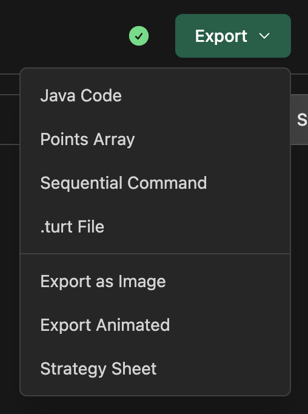
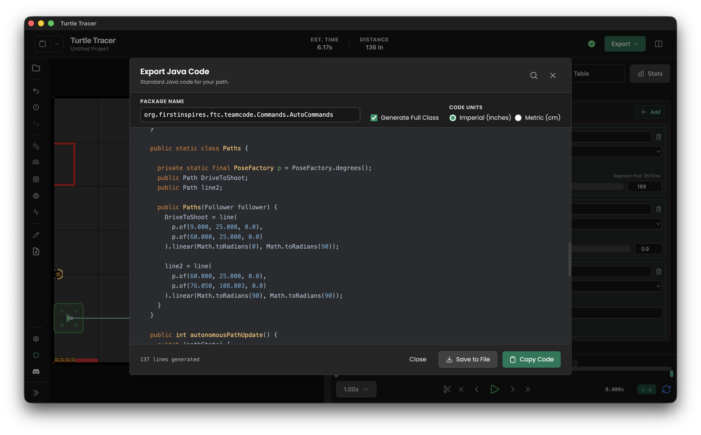
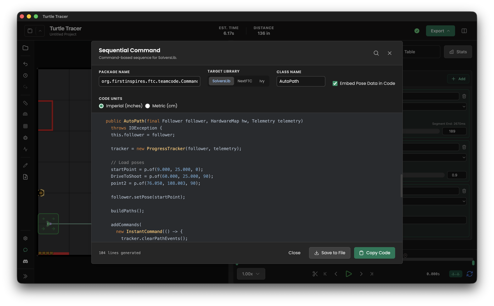

import { Tabs, TabItem } from "@astrojs/starlight/components";
import GeneratedCode from "../../../components/GeneratedCode.astro";

# Exporting Code

Turn your visualized paths into runnable robot code or shareable animations.

## How to Export

Every export starts from the **Export** menu in the top-right corner of the navigation bar.



1.  **Open the Export menu**: Click **Export**, then choose a format: **Java Code**, **Kotlin Code**, **Points Array**, **Sequential Command**, **.turt File**, **Export as Image**, **Export Animated**, or **Strategy Sheet**. You can also use a shortcut, such as <kbd>Ctrl</kbd> + <kbd>Shift</kbd> + <kbd>J</kbd> (or <kbd>Cmd</kbd> + <kbd>Shift</kbd> + <kbd>J</kbd> on macOS) for Java code. See [Controls & Shortcuts](/turtle-tracer/controls/#exporting) for the rest.
2.  **Adjust Options**: Each format opens a dialog with its own options, such as **Package Name**, **Generate Full Class**, **Code Units** (imperial or metric), or the **Target Library** tabs for sequential commands. The code preview updates as you change them.
3.  **Copy or Save**:
    - Click **Copy Code** to paste the generated code into Android Studio.
    - Click **Save to File** to download it as a `.java` file (`.kt` if you export Kotlin), or a `.txt` file for a points array. The **.turt File** dialog has a **Download as .turt** button instead.

## OpMode (Standard)

Generates a complete, standalone OpMode for your autonomous routine, in Java or [Kotlin](#kotlin). This does not support all the functionality of the program due to current limitations.



- **Full Class**: Creates a ready-to-run file including the `OpMode` structure, state machine, and path definitions.
- **Snippets**: Uncheck "Generate Full Class" to get just the path construction code for copy-pasting into your own classes.
- **Hardcoded Paths**: The geometry is baked into the generated file. You do **not** need to put the `.turt` file on the robot.
- **Event Markers**: Each marker becomes a `ProgressTracker` registration that runs the command you registered with `NamedCommands` under the marker's name.

### Example Output

This is the OpMode generated for a three-path routine with a wait, a `SpinUp` event marker on the first path, and an `Intake` marker on the last. The paths are built in a `Paths` class, and a state machine follows them in order:

<GeneratedCode example="routine-opmode" />

Register the `SpinUp` and `Intake` commands before the routine runs, for example in `init()`. See [Named Commands & Events](/turtle-tracer-lib/named-commands/).

## Command-Based (Recommended, Advanced)

Generates a command group for use with command-based frameworks.



- **Supported Libraries**: Pick one with the library tabs in the export dialog, or with **Target Library** in [Settings](/turtle-tracer/settings/#code-export).
  - **SolversLib**: Standard integration.
  - **NextFTC**: Experimental support.
  - **Ivy**: Experimental support for Pedro Pathing's [Ivy](https://github.com/Pedro-Pathing/Ivy). Ivy builds commands with static factories, so the generated class hands back a `Command` from `command()` instead of extending one. Call `Scheduler.reset()` in `init()`, start the routine with `new AutoPath(follower, hardwareMap).command().schedule()`, and call `follower.update()` and `Scheduler.execute()` every loop.
- **Dynamic Loading**: Unless you turn on **Embed Pose Data**, this mode uses `TurtleTracerReader` to load path data from the `.turt` file at runtime. **You must put your `.turt` file on the robot** for this to work. See [TurtleTracerReader](/turtle-tracer-lib/turtle-tracer-reader/).
- **Features**: Automatically handles `FollowPath`, `Wait`, `Turn`, and event triggers. Event markers use TurtleTracerLib events, and each path registers only its own markers, so they trigger on the right path in a chain.

### Example Output

The same routine exported for each library. Without **Embed Pose Data**, the class reads its poses from `AutoPath.turt` and registers each path's event markers just before that path runs:

<Tabs syncKey="command-library">
  <TabItem label="SolversLib">
    <GeneratedCode example="routine-solverslib" />
  </TabItem>
  <TabItem label="NextFTC">
    <GeneratedCode example="routine-nextftc" />
  </TabItem>
  <TabItem label="Ivy">
    <GeneratedCode example="routine-ivy" />
  </TabItem>
</Tabs>

The `.turt` file has to be on the robot for the `TurtleTracerReader` lines to work. See [TurtleTracerReader](/turtle-tracer-lib/turtle-tracer-reader/).

### Gradle setup

To use the command-based exports you need to add the JitPack repository and the TurtleTracerLib dependency to your `teamcode` Gradle configuration (for example, `build.gradle`):

```groovy
repositories {
    maven {
        url 'https://jitpack.io'
    }
}
```

And add the dependency (use the [newest release](https://github.com/Mallen220/TurtleTracerLib/releases) instead of the version shown):

```groovy
implementation 'com.github.Mallen220:TurtleTracerLib:v3.0.3'
```

Exported code is written for Pedro Pathing 3.x. See the [TurtleTracerLib installation guide](/turtle-tracer-lib/installation/) for the Pedro dependencies.

## Kotlin

The OpMode and Sequential Command exports can be written in Kotlin as well as Java. The other formats (Points Array, .turt File, image, animation, and strategy sheet) don't depend on the language.

- **Choosing the language**: **Java Code** and **Kotlin Code** in the Export menu open the OpMode export in that language. Every OpMode and Sequential Command dialog also has a **Language** switch above the code preview. The choice is a setting, so it carries over to the other dialogs, the Code tab, and auto export. You can also change it in [Settings](/turtle-tracer/settings/#code-export).
- **Command libraries**: SolversLib, NextFTC, and Ivy can all write Kotlin. The **Target Library**, **Embed Pose Data**, **Package Name**, and **Code Units** options work the same as for Java. For Ivy, start the routine with `AutoPath(follower, hardwareMap).command().schedule()`, without `new`.
- **Saving**: **Save to File** writes a `.kt` file named after the class.
- **Plugin actions**: A step that comes from a plugin that can't write Kotlin yet is left as a `// TODO` comment, and the dialog warns you. See [Plugins](/turtle-tracer/plugins/).

Every example on this page has a **Kotlin** tab next to **Java**. The tab you pick is remembered across the docs.

## Other Formats

- **Points List**: A raw array of coordinates (e.g., `[(10, 10), (20, 20)]`) for custom processing or debugging.
- **Project File (.turt)**: Download the source file to share with teammates or back up your work. The project data preview shows exactly what saving will write, including unsaved changes. Older `.pp` files can still be opened.

## Animation Export

Create high-quality visualizers to share your strategy.

- **Formats**:
  - **GIF**: Best for compatibility (Discord, Slack).
  - **APNG**: Higher quality with transparency support, and smaller file sizes.
- **Quality Controls**: Adjust **FPS**, **Scale**, and **Quality** to balance file size and visual fidelity.

## Dialog Tools

- **Search (Ctrl+F)**: Quickly find specific lines or markers in the generated code.
- **Package Name**: Set your team's package (e.g., `org.firstinspires.ftc.teamcode`) to fix imports automatically.
- **Code Units**: Generate the code in imperial (inches) or metric (cm). For sequential commands, metric code generation requires **Embed Pose Data in Code**, and the dialog warns you if it's off.
- **Save to File**: Directly save `.java` or `.txt` files to your computer.
