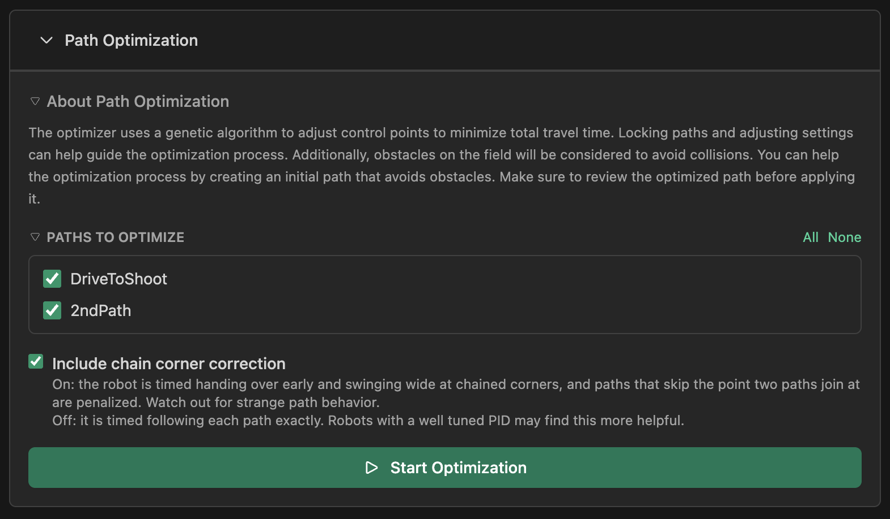

# Path Optimization

The **Path Optimizer** uses a genetic algorithm to automatically refine your autonomous paths. It evolves your path over multiple generations to find the fastest route while strictly avoiding collisions.

You'll find it in the **Field** tab, in the **Path Optimization** panel.

## Core Concepts

The optimizer treats your path like a living organism that evolves. It tries thousands of variations to balance two competing goals:

1.  **Speed**: Minimizing travel time based on your robot's constraints (velocity, acceleration).
2.  **Safety**: Avoiding all defined obstacles and field boundaries.

## Before You Start

For the optimizer to work effectively, ensure your **Settings** are accurate:

- **Robot Dimensions**: Set the correct `Length` and `Width` of your robot.
- **Safety Margin**: Add a buffer (e.g., 2 inches) to ensure you don't graze obstacles. The more precise the drive train the smaller the buffer.
- **Motion Settings**: Set your robot's real velocities, acceleration, and Translational P. The optimizer uses them to time chained corners.
- **Obstacles**: Define accurate obstacles in the "Obstacles" tab.

## The Optimization Process

When you run the optimizer, it follows these steps:

1.  **Initialization**: It starts with your current path and creates 50+ variations (the "population").
2.  **Evaluation**: It simulates every path to calculate travel time and check for collisions.
3.  **Selection**: It keeps the fastest, safest paths. Colliding paths are heavily penalized.
4.  **Mutation**: It slightly modifies the survivors—moving control points or adding/removing them—to explore new solutions.
5.  **Repeat**: This cycle repeats for the defined number of iterations.

> **Note**: The optimizer will automatically add or remove control points if it helps navigate around an obstacle.

## Chained Paths and Sharp Corners

The optimizer can handle chained paths where the robot has to swing wide at a sharp corner. When your project has chained paths, the Path Optimization panel shows an **Include chain corner correction** checkbox before you start a run. It is on by default, applies to that run only, and isn't saved as a setting.

- **On**: The robot is timed handing over early and swinging wide at chained corners. A swing into an obstacle counts as a collision, and paths that skip the point where two paths join are penalized. Watch out for strange path behavior.
- **Off**: The robot is timed following each path exactly. Robots with a well-tuned PID may find this more helpful. Once you apply a path optimized this way, the simulation includes the corner correction, so its time and route can differ from what the optimizer reported.

After a run, the panel tells you how many sharp chained corners are left in the optimized path. These are warnings, so you can still apply the path. Check [Path Statistics](/turtle-tracer/simulation/#chained-paths) and verify the path yourself.

## Understanding the Settings

You can tune the optimizer in the **Settings** menu. Here is what each knob does:

### 1. Optimization Iterations

- **What it is**: The number of generations the algorithm runs.
- **Effect**: Higher values give the optimizer more "time to think."
- **Recommendation**: Start with **100**. Increase to **300+** for complex obstacle courses.

### 2. Population Size

- **What it is**: The number of path variations tested in each generation.
- **Effect**: Larger populations explore more options but run slower.
- **Recommendation**: **50** is usually sufficient.

### 3. Mutation Rate

- **What it is**: The probability that a control point will be moved in a generation.
- **Effect**:
  - **Low (0.1)**: Fine-tuning. Good for polishing a nearly perfect path.
  - **High (0.5)**: Exploration. Good for finding completely new routes.
- **Recommendation**: Default is **0.4**.

### 4. Mutation Strength

- **What it is**: The maximum distance (in inches) a point can move during a single mutation.
- **Effect**:
  - **Low (1.0)**: Small nudges.
  - **High (10.0)**: Large jumps.
- **Recommendation**: Default is **6.0**. The optimizer automatically increases this if the path is currently colliding.

## Pro Tips

- **Locking**: If you have a segment you _know_ is perfect (e.g., scoring alignment), select the line and check **Lock Line**. The optimizer will not touch it.
- **Good Start**: Give the optimizer a rough path that is somewhat close to valid. It works faster if it doesn't have to untangle a complete mess.
- **Visual Feedback**: The dashed line shows the best path found so far. If it stops improving, you can click **Stop Optimization** early.
