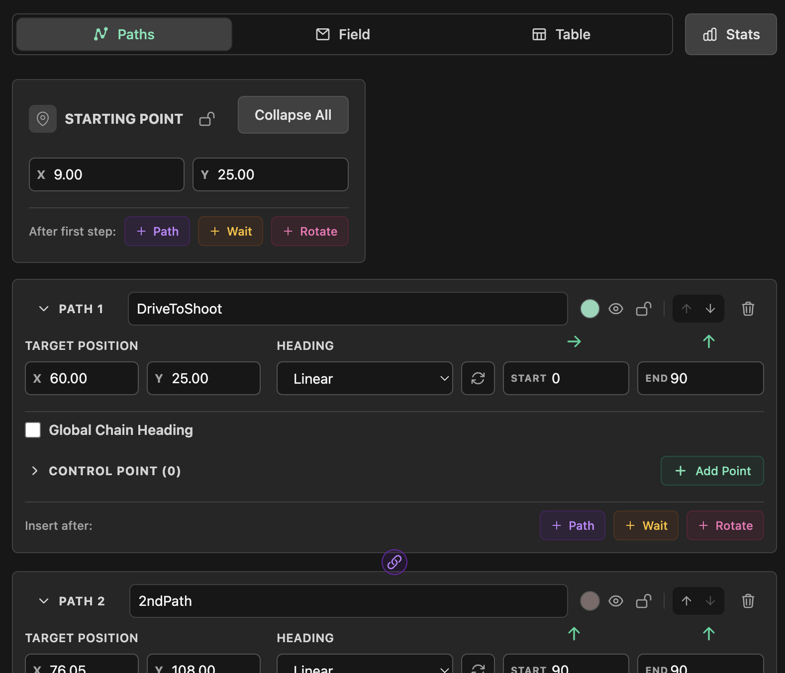
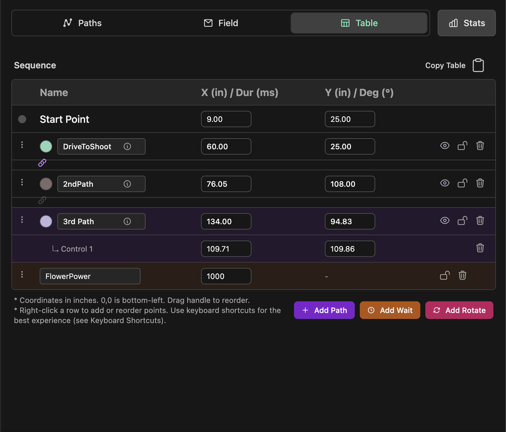

# Path Editing

The path editor allows you to create complex autonomous routines using Bezier curves. Each segment of your path is managed through its own panel in the sidebar.

## Path Panels

Each path segment has a dedicated panel with several controls:

- **Expand/Collapse**: Click the arrow or path name to show or hide details.
- **Renaming**: Click the name to rename. **Tip:** Paths with the **same name** are "linked" — moving one automatically moves the others.
- **Locking**: Click the **Lock Icon** to prevent accidental edits to a path.
- **Color**: Click the color circle to verify or change the path's color.
- **Reorder**: Use the **Up/Down Arrows** to change the sequence of the path.

## Point Configuration

Inside an expanded panel, you can precisely configure the endpoint:

- **Position**: Manually enter **X** and **Y** coordinates (in inches). Inputs respect your grid snapping settings.
- **Heading Modes**: Control the robot's orientation:
  - **Constant**: Robot maintains a fixed heading (Degrees).
  - **Linear**: Heading changes smoothly from a **Start** angle to an **End** angle.
  - **Tangential**: Robot faces the direction of travel. Check **Reverse** to drive backwards.

## Control Points

The **Control Points** section allows you to shape the Bezier curve:

- **Add/Remove**: Click **Add Point** in the Control Point row to create complex curves. Use the trash icon to remove them.
- **Precise Editing**: Enter exact X/Y coordinates for every control point.
- **Reorder**: Drag and drop control points in the list to change their order of influence.

## Panel Actions

At the top right of each path panel, next to the color circle:

- **Eye**: Hide the path on the field, or show it again.
- **Lock**: Prevent accidental edits to the path.
- **Up/Down Arrows**: Move the path earlier or later in the sequence.
- **Trash**: Remove the path.

At the bottom of the panel, the **Insert after:** row adds a step right after this path:

- **+ Path**: Insert a new path.
- **+ Wait**: Insert a stop/wait command.
- **+ Rotate**: Insert a turn in place.

## Table View

The **Table** tab lists the whole sequence in one place: the start point, every path with its control points, and any waits and rotations. Edit coordinates and durations inline, drag the handle to reorder rows, or right-click a row for more actions. **Add Path**, **Add Wait**, and **Add Rotate** at the bottom add a step to the end. **Copy Table** puts the sequence on your clipboard as Markdown.

## Keyboard Shortcuts

- **Add Point**: `Double Click` on field map
- **Delete**: `Backspace` or `Delete` key
- **Duplicate**: `Shift + D`
- **Undo/Redo**: `Ctrl + Z` / `Ctrl + Y`
