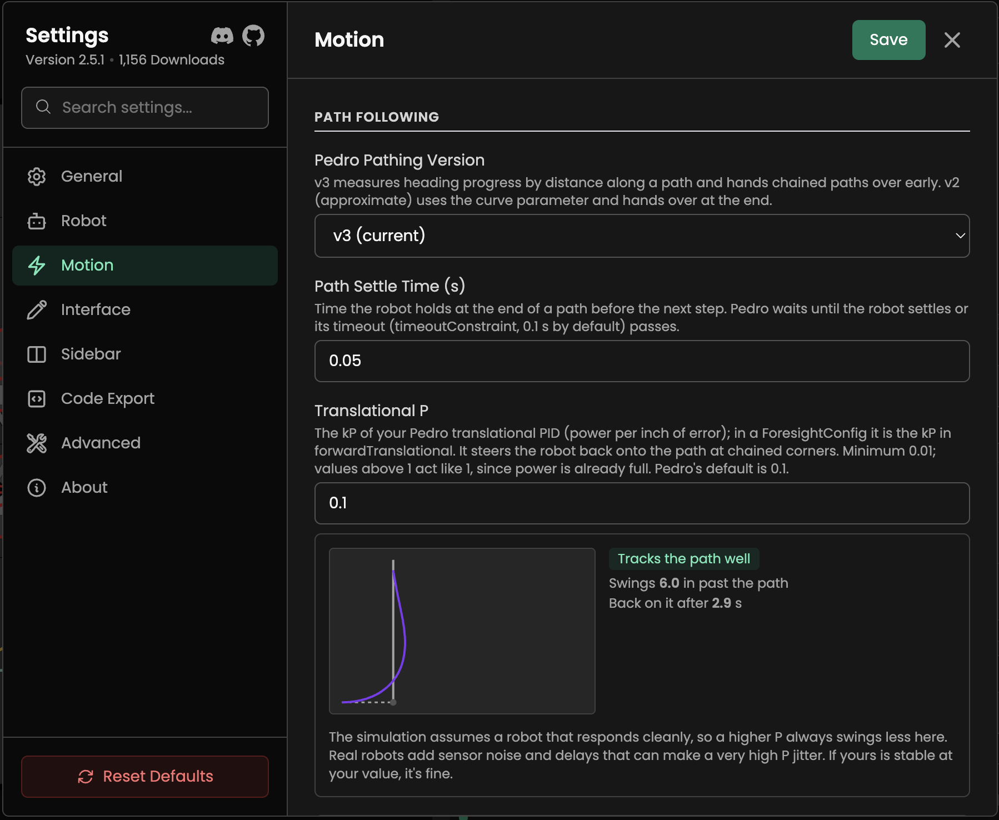
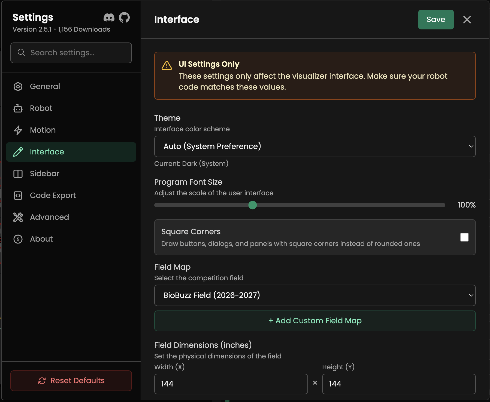

# Settings

The settings menu allows you to configure the visualizer to match your robot's physical properties, adjust the interface, and manage code export options.

Open it with <kbd>Ctrl</kbd> + <kbd>,</kbd> (<kbd>Cmd</kbd> + <kbd>,</kbd> on macOS) or the gear at the bottom of the left sidebar. A few things work the same on every tab:

- **Search settings**: The box at the top of the tab list finds a setting on any tab.
- **Reset a setting**: A setting you have changed shows a reset arrow that puts it back to its default.
- **Reset Defaults**: The button at the bottom of the tab list resets every setting, after you confirm.
- **Save**: Click **Save**, press `Esc`, or click outside the menu to save your changes and close it.

> **Important:** Most of these settings (especially in Robot and Motion tabs) affect the **visualizer only**. Ensure your robot's code constants match these values for accurate simulation.

## General

General application settings.

- **Autosave Mode**: Choose when to automatically save your project. The default is **Never**.
  - **Never**: Manual save only.
  - **Time Based**: Save automatically at a set interval.
  - **On Change**: Save after every change.
  - **On Close**: Save when closing the application.
- **Autosave Interval**: (Visible if _Time Based_ is selected) How often to save: 1, 5, 10, 15, 20, 40, or 60 minutes. The default is 5.
- **Welcome Tutorial**: Click **Start Tutorial** to replay the onboarding guide.
- **Software Update**: (Desktop app) Click **Check for Updates** to see if a new version is available.
- **Show Live Telemetry Tab**: Show the **Telemetry** tab in the control panel, which connects to a robot running [Live View](/turtle-tracer-lib/live-view/). It is off by default, and the setting isn't shown in the browser version while you are online.
- **Keyboard Shortcuts**: Click **Open Editor** to view and customize key bindings.
- **Plugin Manager**: (Desktop app) Click **Open Manager** to manage installed plugins.
- **Git Integration**: (Desktop app) Show git status indicators for files. It is on by default.
- **Transfer Settings**:
  - **Export**: Save your current settings to a JSON file.
  - **Import**: Load settings from a JSON file.

## Robot

Configure your robot's physical dimensions and appearance.

- **Robot Profiles**: Save and load different robot configurations. A profile stores your dimensions, velocities, and the Motion settings that describe how your robot drives, including Translational P, the braking coefficients, and Path Settle Time. You can create, load, overwrite, export, import, and delete profiles. Profiles saved by older versions keep your current values for the newer fields.
- **Dimensions**:
  - **Robot Length (in)**: Length of the robot base, from 1 to 36.
  - **Robot Width (in)**: Width of the robot base, from 1 to 36.
- **Validation**:
  - **Disable Validation**: Turn off all path validation. The three settings below are hidden while it is on.
  - **Safety Margin (in)**: Buffer zone around obstacles and field boundaries, from 0 to 24. The default is 2.
  - **Validate Field Boundaries**: Warn if the robot leaves the field.
  - **Continuous Validation**: Show validation issues in real time. It is off by default.
- **Restrict Dragging**: Keep points inside the field boundaries while you drag them. It is on by default.
- **Robot Image**: How the robot is drawn on the field.
  - **No Image (Recommended)**: The default. The robot is drawn as a green square with arrows. With this choice you can also set the **Drive Train Visualization** (**Holonomic** or **Swerve**), turn **Show Wheel Arrows** on or off, and add features to the robot with the **rectangle**, **circle**, and **line** buttons, to match your real robot's shape.
  - **Lightweight Image**: A small built-in robot picture.
  - **Use Potato Robot** and **Use Turtle Robot**: Two more built-in options.
  - **Upload Custom**: Use your own top-down image of your robot.
- **Show Fake Heading Arrow** and **Heading Arrow Color**: (With any picture other than the lightweight default) Draw an arrow showing which way the robot faces, which helps when a custom image doesn't make it obvious.

## Motion

Simulate robot physics for path timing and visualization. Each field has a short description in the app that names the matching Pedro Pathing constant, so you can copy your real values across.

- **Fill in from your Pedro constants file**: A collapsed section at the top. Paste your whole `Constants.java` (or `.kt`) and Turtle Tracer lists each setting it can read from it, with the value it has now and the one in your file, and the Pedro name it came from. Nothing changes until you press the button. It reads Pedro 3 `ForesightConfig` files (`maxAchievableForwardVelocity`, `maxAchievableStrafeVelocity`, `maxVelocityConstraint`, `maxAccelerationConstraint`, `maxDecelerationConstraint`, `timeoutConstraint`, and the brake coefficients) and the older Pedro 2 names (`xVelocity`, `yVelocity`, `PathConstraints`). It also sets the Pedro version and your constants class and follower method for exported code. It only sees numbers written in the file, as plain values, simple sums and products, or variables set in the same file. A value it can't work out is left alone. Max Velocity becomes your forward velocity unless you set a lower `maxVelocityConstraint`.

  Two things are left out on purpose, because the file's values would make the simulation less accurate. **Translational P** is not your Pedro kP: Pedro uses separate forward and strafe gains and caps braking power, so the value that makes the simulation swing like your robot at a corner is lower, and the Telemetry tab fits it from real corners. **Max Deceleration** is not read from `naturalForwardDeceleration` or `forwardZeroPowerAcceleration`, which are how fast the robot slows with no power, about a third of how fast it brakes. Measure it with the Telemetry tab, or set a `maxDecelerationConstraint`.
- **Velocity**:
  - **Forward Velocity**: Top speed driving the way the robot faces (in/s). Pedro: `maxAchievableForwardVelocity`.
  - **Strafe Velocity**: Top speed driving sideways (in/s). Pedro: `maxAchievableStrafeVelocity`. Set it equal to Forward Velocity for a robot that is as fast in every direction.
  - **Max Velocity**: The fastest the robot goes along a path (in/s). A good start is your forward velocity.
  - **Angular Velocity**: Max rotation speed (supports rad/s or deg/s).
- **Acceleration**:
  - **Max Acceleration**: Max acceleration (in/s²).
  - **Max Deceleration**: Max deceleration (in/s²). If you enter braking coefficients below, those are used instead.
  - **Max Angular Acceleration**: Max angular acceleration (rad/s² or deg/s²). Set to 0 to auto-calculate.
- **Friction**:
  - **Friction Coefficient**: Higher values mean more grip. It is used for the wheel slip warning in Path Statistics.
- **Path Following**:
  - **Pedro Pathing Version**: `v3` (the default) measures heading progress by distance along a path and hands chained paths over early. `v2` (deprecated but still widely used) uses the curve parameter and hands over at the end.
  - **Path Settle Time (s)**: How long the robot holds at the end of a path before the next step. The default is `0.05`.
  - **Translational P**: The kP of your Pedro translational PID (power per inch of error). It steers the robot back onto the path at chained corners. The minimum is `0.01`, and values above `1` act like `1`. Pedro's default, and this setting's, is `0.1`. A small corner preview shows what a value does.
  - **Stop to Turn**: Stop and turn in place before a path that starts at a different heading. It is off by default, because Pedro turns while it drives.
- **Advanced braking**: A collapsed section holding Pedro's braking model, where distance to stop = quadratic × speed² + linear × speed.
  - **Braking Distance, Quadratic** and **Braking Distance, Linear**: Leave both at `0` to brake at the max deceleration. In a `ForesightConfig` these come from `quadraticBrakeCoefficients` and `linearBrakeCoefficients`; use the forward values.

:::note[Removed settings]
**Slow Down for Curves** and **Heading Response Time** were removed in 2.4.0, because they changed the results very little.
:::

## Interface

Customize the visualizer's appearance and behavior. These settings only change what you see in Turtle Tracer, not your robot's code.

- **Theme**: Select Auto (System Preference), Light Mode, Dark Mode, or an installed custom theme. The default is Auto.
- **Program Font Size**: Adjust the UI scaling, from 75% to 150% in steps of 5. The default is 100%.
- **Square Corners**: Draw buttons, dialogs, panels, and inputs with square corners instead of rounded ones. It is off by default.
- **Field Map**:
  - Select the season's field image.
  - **Add Custom Field Map**: Upload your own field image.
- **Field Dimensions (inches)**: The width and height of the field, each from 12 to 500. They are 144 × 144 for the standard field.
- **Field Orientation**: Rotate the field view by 0°, 90°, 180°, or 270°.
- **Coordinate System**: Choose **Pedro Pathing (0-144)** or **FTC Center (±72)**.
- **Visualizer Units**: Show the interface in **Imperial (Inches)** or **Metric (cm)**. Code export has its own units setting under [Code Export](#code-export).
- **Robot Onion Layers**: Show the robot body at intervals along the path. It is off by default.
  - **Show Only on Current Path**: Only show onion layers for the selected path.
  - **Onion Layer Spacing**: Distance between layers, from 2 to 20 inches. The default is 6.
- **Smart Object Snapping**: Snap points to align with other waypoints. Hold <kbd>Alt</kbd> / <kbd>Option</kbd> to invert it. It is on by default.
- **Velocity Heatmap**: Color the path by robot speed, from green to red. It is off by default.
- **Velocity Tooltips**: Show velocity, time, and distance traveled at any point in a path on hover. It is off by default.
- **Lock Field View**: Lock the view so you can't pan or zoom by accident. It is off by default.
- **Follow Robot**: Automatically pan the view to keep the robot centered during simulation. It is off by default.

## Sidebar

Choose what appears in the [Left Sidebar](/turtle-tracer/sidebar/).

- **Sidebar Icon Size**: From 16 to 32 px. The default is 20.
- **Active Sidebar Layout**: Drag rows to reorder, use the arrows for precision, or click **×** to remove an item.
- **Reset Sidebar**: Restore the default layout and remove all custom tools.

You can also add your own buttons for any action in the Command Palette. See [Left Sidebar](/turtle-tracer/sidebar/#adding-custom-buttons).

## Code Export

Configure how code is generated from your paths. This tab is in the desktop app only. The **Auto Export Code** setting writes a file every time you save. The same **Language**, **Package Name**, and **Code Units** also fill in the [Export dialogs](/turtle-tracer/exporting/).

- **Auto Export Code**: Automatically generate code when the project is saved. It is off by default, and the settings below appear when it is on.
- **Export Path Mode**:
  - **Relative**: Path relative to the project file (e.g., `GeneratedCode`).
  - **Absolute**: Full system path.
- **Export Path**: Directory where the code will be saved. The default is `GeneratedCode`, and the folder button lets you browse for one.
- **Export Format**:
  - **OpMode Class**: Generates a standalone OpMode that needs no command library.
  - **Sequential Command**: Generates command-based code.
  - **Points Array**: Exports raw points.
  - **.Turt Project Data**: Exports the project file.
- **Code Units**: **Imperial (Inches)** or **Metric (cm)** in the generated code. For sequential commands, metric needs **Embed Pose Data**, and the tab warns you if it's off.

### Format Specific Settings

**OpMode Class:**

- **Generate Full Class**: Include class definition and imports.
- **Telemetry Implementation**: Choose the telemetry backend: **Panels (Bylazar)**, **Standard (FTC)**, **FtcDashboard + Standard**, or **None**.

**Sequential Command:**

- **Target Library**: Choose between `SolversLib`, `NextFTC`, or `Ivy`. NextFTC and Ivy output is experimental.
- **Embed Pose Data**: Embed pose data directly in the code (no `.turt` file needed).

**OpMode Class and Sequential Command:**

- **Language**: Write the code in **Java** or **Kotlin**. Kotlin files are saved as `.kt`. See [Kotlin export](/turtle-tracer/exporting/#kotlin).
- **Package Name**: Package for the generated class. The default is `org.firstinspires.ftc.teamcode.Commands.AutoCommands`.

## Advanced

Advanced visualization and optimization settings.

- **Show Debug Sequence**: Display internal sequence execution order.
- **Draw Tool Tolerance**: How aggressively a drawn path is simplified, from 1 to 60. The default is 5.
- **Draw Tool Tension**: How tight the curves of a drawn path are, from 0 to 1. The default is 0.38.
- **Path Optimization**:
  - **Optimization Iterations**: Number of generations the genetic algorithm runs, from 10 to 3000. The default is 300.
  - **Population Size**: Number of candidate paths per generation, from 10 to 200. The default is 100.
  - **Mutation Rate**: The fraction of control points mutated, from 0.01 to 1. The default is 0.4.
  - **Mutation Strength**: The furthest a control point can move in one mutation, in inches, from 0.1 to 20. The default is 6.

## About

Shows the version you are running, the license, and links to the documentation, GitHub, Discord, issues, and releases.
