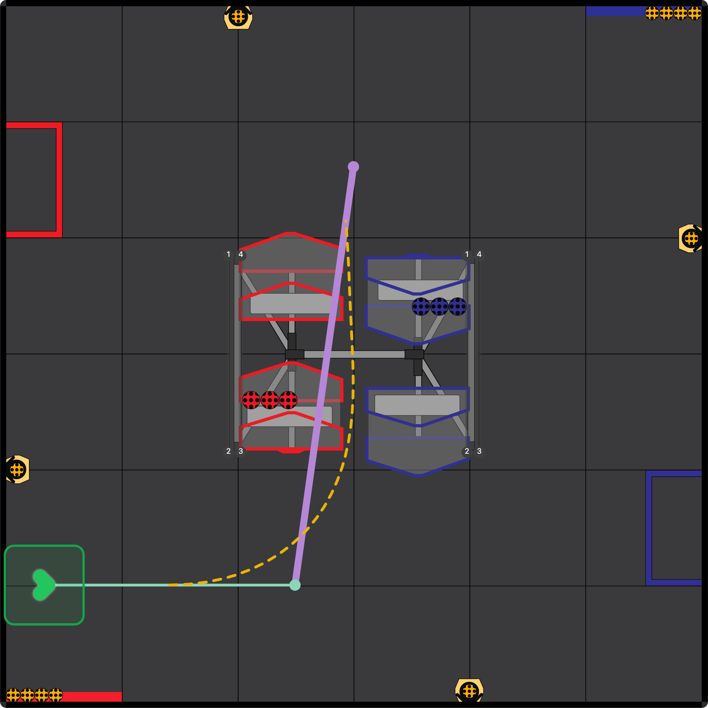

# Simulation & Playback

Visualize your robot's path with a physics-based simulation. This tool helps you verify timing, check for collisions, and ensure smooth motion before running code on the real robot.

## Playback Controls

Located at the bottom of the screen, the control bar manages the simulation:

- **Play/Pause**: Start or stop the animation. (Shortcut: `Space`)
- **Timeline Scrubbing**: Drag the slider to jump to any point in the path. A live hover preview with a Ghost Robot will appear.
- **Speed Control**: Adjust playback speed from **0.25x** (slow motion) to **3.0x** (fast forward).
- **Loop**: Toggle continuous looping of the animation.

## Visual Aids

Enable these overlays in **[Settings](/turtle-tracer/settings/)** to better understand robot behavior:

- **Onion Skinning**: Displays a trail of robot bodies at regular intervals. Helps visualize how the robot rotates and moves through complex curves.
- **Velocity Heatmap**: Colors the path line based on speed.
  - **Green**: Slow movement or stopping.
  - **Red**: Fast movement.

## Physics & Accuracy

The simulation uses your robot's configured constraints to predict real-world performance:

- **Kinematics**: Accurately models holonomic (omni-directional) movement.
- **Velocity Limits**: Respects the **Max Velocity** and **Angular Velocity** settings.
- **Acceleration**: Accounts for **Max Acceleration** to predict realistic travel times. Travel time estimates include acceleration, and distance on curved paths is measured along the curve instead of as straight segments.
- **Braking**: Uses **Max Deceleration**, or the braking coefficients if you enter them in the [Motion settings](/turtle-tracer/settings/#motion).
- **Headings**: Large heading changes take the short way around. Before its first path, the robot faces the way that path starts, even when the first path is inside a macro, so exported code starts from the same heading as the preview.
- **Turns**: By default the robot turns while it drives, as Pedro does. Turn on **Stop to Turn** in the Motion settings to have it stop and turn in place before a path that starts at a different heading.

### Chained Paths

When paths are chained, the robot doesn't stop at the join. Turtle Tracer simulates the corner the way Pedro Pathing drives it:

- The robot can't turn instantly, so it carries on past the join, swings out, and steers back onto the next path (overshooting).
- The field shows the swing as a dashed line, the playback follows it, and the time includes it.
- The Table counts the swing in the time of the path it leads onto. The speed tooltip and heatmap skip the part of a path the robot doesn't drive.
- Sharp corners, and corners where the robot misses the join point, get a warning. See [Path Validation](/turtle-tracer/validation/#5-chain-corner-chained-corners).

How hard the robot steers back depends on the **Pedro Pathing Version**, **Translational P**, and **Path Settle Time** settings. Match them to your robot's values.

## Verification Tools

Ensure your path is safe and efficient:

- **Collision Detection**: Potential collisions with field boundaries or defined obstacles are marked with warning indicators. [Learn more about Path Validation](/turtle-tracer/validation/).
- **Real-time Feedback**: The "Current Robot Position" panel displays live X/Y coordinates and heading during playback.
- **Event Markers**: Visual dots on the timeline show exactly when events (like "Intake" or "Shoot") will trigger. [Learn more about Event Markers](/turtle-tracer/event-markers/).

---

## Path Statistics

Use the **Stats** button to see the total estimated duration and distance of your routine, with timing, length, and peak speed for each segment. The **Graphs** tab plots velocity and acceleration, and **Insights** lists warnings such as wheel slip and chained corners.
